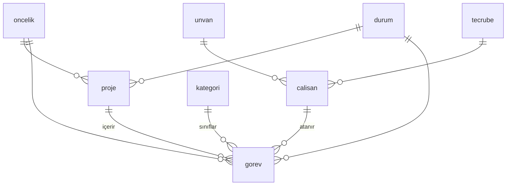

# Proje Yönetimi

C# (Windows Forms) ve SQL Server ile yazılmış masaüstü **proje, görev ve çalışan yönetimi** uygulaması.


## Özellikler

| Bölüm | Neler yapılabilir |
|---|---|
| **Giriş** | Kullanıcı adı / şifre ile giriş (şifreler SHA-256 ile saklanır) |
| **Anasayfa** | Proje, görev ve çalışan sayıları, toplam bütçe, proje bütçe dağılımı grafiği, takvim |
| **Projeler** | Proje ekleme, tüm projeler, durumuna göre listeler (Yeni / Güncel / Tamamlanmış), tablo üzerinden toplu güncelleme ve silme, projeye ait görevler |
| **Çalışanlar** | Çalışan ekleme, listeleme, güncelleme, çalışana atanan görevler |
| **Görevler** | Kategori ekleme, görev ekleme (proje, kategori, atanan kişi, tarih, öncelik, durum, maliyet), görev listesi |

## Kurulum

### Gereksinimler

- Windows
- [Visual Studio 2022](https://visualstudio.microsoft.com/) (".NET masaüstü geliştirme" iş yükü)
- [SQL Server Express](https://www.microsoft.com/sql-server/sql-server-downloads) + SQL Server Management Studio

### Adımlar

1. **Veritabanını oluşturun:** `database/ProjeYonetimi.sql` dosyasını SQL Server Management Studio'da açıp çalıştırın (F5).
2. **Bağlantıyı ayarlayın:** `src/ProjeYonetimi/App.config` içindeki `Data Source` değerini kendi SQL Server adınızla değiştirin.
   Varsayılan değer `.\SQLEXPRESS`'tir.
3. **Çalıştırın:** `ProjeYonetimi.sln` dosyasını Visual Studio ile açıp **F5**'e basın.
   Arayüz kütüphanesi (ReaLTaiizor) NuGet'ten otomatik olarak indirilir.
4. **Giriş yapın:** kullanıcı adı `admin`, şifre `admin`.

## Proje yapısı

```
ProjeYonetimi.sln
├── database/
│   └── ProjeYonetimi.sql        # Tablolar, ilişkiler ve örnek veriler
└── src/ProjeYonetimi/
    ├── Program.cs               # Giriş noktası (önce giriş ekranı açılır)
    ├── App.config               # Veritabanı bağlantı cümlesi
    ├── Data/
    │   └── Veritabani.cs        # Tüm SQL işlemleri (parametreli sorgular)
    └── Forms/
        ├── GirisForm.cs         # Giriş ekranı
        └── AnaForm.cs           # Ana ekran (Anasayfa, Projeler, Çalışanlar, Görevler)
```

## Veritabanı şeması



## Sürüm 2.0'daki değişiklikler

- Proje klasör yapısı düzenlendi (`projeeee` → `src/ProjeYonetimi`, `Forms/` ve `Data/` klasörleri).
- Derleme çıktıları (`bin/`, `obj/`) depodan kaldırıldı, `.gitignore` eklendi.
- Depoda olmayan veritabanı için kurulum scripti eklendi.
- Uygulama artık giriş ekranından başlıyor (önceden giriş atlanıyordu).
- Giriş ve çalışan güncellemedeki SQL injection açıkları kapatıldı, şifreler özetlenerek saklanıyor.
- Bağlantı cümlesi koda gömülü değil, `App.config`'den okunuyor.
- Bağlantılar her işlemde açılıp kapanıyor, hatalar anlaşılır mesajlarla gösteriliyor.
- Boş alan, tarih ve tutar kontrolleri eklendi (`₺1.250,50` gibi girişler doğru okunuyor).
- Proje Güncelle ekranı düzeltildi: önceden kaydetme çalışmıyordu, artık düzenleme ve silme kaydediliyor.
- Kontrol isimleri anlamlı hale getirildi (`dataGridView3` → `dgvGuncelProjeler` gibi).
- Tablo başlıkları Türkçeleştirildi; tarih ve para biçimleri düzeltildi.
- Proje SDK tarzı `.csproj` formatına geçirildi; NuGet paketi otomatik geliyor.

## Lisans

[CC0 1.0](LICENSE) — serbestçe kullanılabilir.
